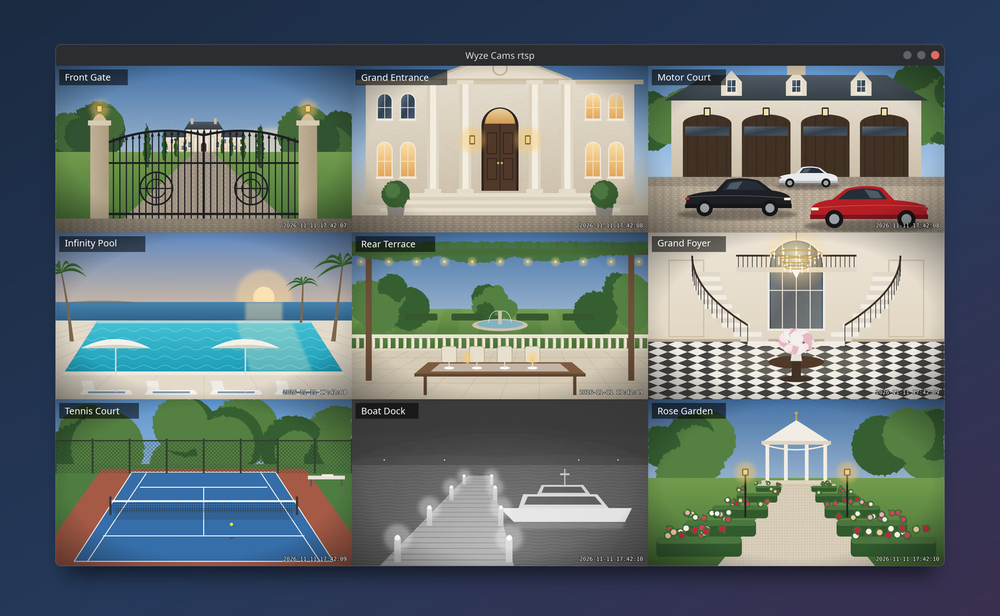
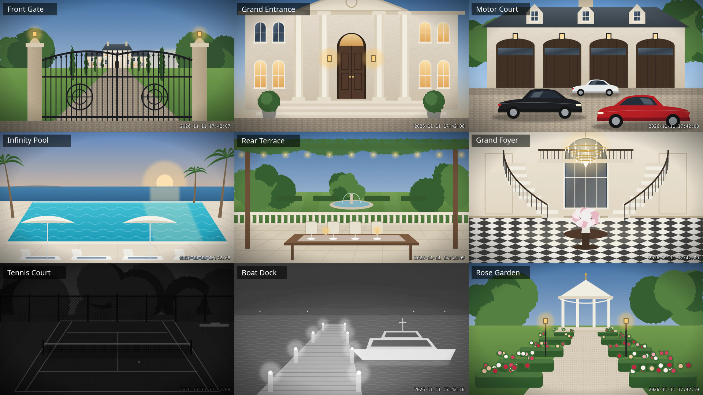

# wyzecam-rtsp

View your Wyze cameras' built-in RTSP streams in one live grid on **Linux, macOS or Windows**:
no Wyze app and no cloud. It scans your network, finds the cameras, and shows them tiled in a
single window with names, auto-reconnect, and live rearranging.



> **Important:** this only works with cameras that provide an RTSP stream, and it has only been
> tested with Wyze Cams. Other RTSP cameras may need a different port or stream path.

## Screenshots

| | |
|---|---|
|  |  |
| **Arrange live:** press 1–9 to pick a camera (yellow border), then use the arrow keys to move it and **s** to save the layout. | **Zoom:** press **z** to fill the window with the selected camera, and **z** again to go back to the grid. |
|  |  |
| **Keeps going:** a camera that drops turns dark grey and reconnects by itself. The other cameras keep playing. | **Help on screen:** press **h** to show every key. |

*These are illustrated mockups. The estate scenes are drawings, but the layout, name labels,
selection border, grey reconnecting tile and on-screen messages match what the app shows.*

## 1. Turn on RTSP on each camera

RTSP is **off by default**. For each camera whose model and firmware support it, open the Wyze
mobile app: camera → **Settings → Advanced Settings → RTSP**, turn it on, and set a username and
password. Tested with Cam v3, Cam Pan v3 (production firmware) and Cam v4 (RTSP firmware).

Use the same username and password on every camera. Type them at the login prompt, or fill in
`DEFAULT_USER` / `DEFAULT_PASS` near the top of the script (or set `WYZE_RTSP_USER` /
`WYZE_RTSP_PASS`) so you can just press Enter.

## 2. Install (once)

| OS | Install | Run |
|---|---|---|
| **Linux** (Pop!_OS / Ubuntu) | `sudo apt install python3 ffmpeg mpv` | `./wyzecam-rtsp.py` |
| **macOS** | `brew install python ffmpeg mpv` | `./wyzecam-rtsp.py` |
| **Windows** | Python from [python.org](https://www.python.org/downloads/), then<br>`winget install -e --id Gyan.FFmpeg`<br>`winget install -e --id shinchiro.mpv` | `py wyzecam-rtsp.py` |

Put `wyzecam-rtsp.py` in its own folder. Its camera list (`cameras.json`) and logs are kept
next to it. On Linux/macOS, run `chmod +x wyzecam-rtsp.py` once.

**First-run permissions:**
- **macOS:** the first scan triggers a **Local Network** permission request for your terminal app.
  Allow it (System Settings → Privacy & Security → Local Network). Without it the scan finds nothing.
- **Windows:** if Windows Firewall asks about Python, allow it on **Private networks**.
  Open a new terminal after installing ffmpeg/mpv so they're on the PATH.

## 3. Use it

On Windows, use `py wyzecam-rtsp.py` wherever this says `./wyzecam-rtsp.py`.

```
./wyzecam-rtsp.py                 # play all cameras (scans automatically the first time)
./wyzecam-rtsp.py --scan          # rescan the network, then play
./wyzecam-rtsp.py -c 243,patio    # only these cameras, in this order
./wyzecam-rtsp.py -x 75           # everything except camera 75
./wyzecam-rtsp.py --sub           # lighter substreams: less Wi-Fi and CPU, plenty for a grid
./wyzecam-rtsp.py name            # name cameras while watching each one
./wyzecam-rtsp.py arrange         # set the saved order / which cameras show
./wyzecam-rtsp.py --list          # list saved cameras
./wyzecam-rtsp.py --help          # every option
```

**Keys in the grid** (click the window first):

| Key | Action | Key | Action |
|---|---|---|---|
| f | fullscreen | 1–9 | select a camera (yellow border) |
| n | names on/off | arrows | move the selected camera |
| r | resync all to live | d | hide it |
| h | help | e | rename it |
| q | quit | a | show all hidden |
| z | zoom selected | s | save the layout |

A **dark grey tile** means that camera has no live video right now. It keeps retrying on its own.

## How it behaves

- Each camera has its own decoder and reconnect loop, so a bad camera never freezes the others.
- Every camera reconnects every 10 minutes (staggered) to stay close to live (`--resync`).
- A camera whose main stream keeps dropping switches to its substream automatically,
  and that setting is saved.
- GPU decoding is used where available: VA-API on Linux, VideoToolbox on macOS, D3D11 on Windows.
- Logs: `wyzecam-rtsp.log` (events) and `wyzecam-rtsp-ffmpeg.log` (details, passwords removed).

## Using it alongside the Wyze app, and during internet outages

**Can I still use the Wyze phone app?** Yes. Turning on RTSP is just a setting, and the Wyze app
keeps working: motion alerts, event clips, and settings are unaffected. Live view in the app is a
second, separate stream from the camera, though, so be aware of two things:

- On cameras with weak Wi-Fi, opening live view on your phone can make that camera's grid tile drop
  for a moment. The grid reconnects it on its own.
- Some owners report that the Wyze app's live view becomes unreliable on certain firmware while RTSP
  is streaming, notably the [Cam v4 RTSP beta](https://forums.wyze.com/t/wyze-cam-v4-firmware-beta-test-7-27-2026/344026?page=3)
  and the [February 2026 Cam v3 / Pan v3 firmware](https://forums.wyze.com/t/wyze-firmware-updates-2-2-2026/340669?page=3).
  If that happens to you, it's the camera firmware, not this tool. Check each camera's live view in
  the app while the grid is running.

**Is the video local? Does it work without internet?** The video goes **directly from each camera to
your computer over your home network**. It never passes through the internet or Wyze's servers, and
this tool needs no internet connection.

Whether the *cameras* keep streaming RTSP when your internet goes down is a separate question:

- **While the cameras stay powered on, owners report that RTSP keeps working.** For example, a
  [Pan v3 owner unplugged their internet](https://forums.wyze.com/t/isp-down-and-no-local-access/343086)
  and could still stream over RTSP while the Wyze app showed every camera offline, and another
  [kept RTSP through a 16-hour ISP outage](https://forums.wyze.com/t/can-you-use-cams-without-internet/24471?page=3).
- **A camera that restarts or loses power while the internet is down may not come back.** Wyze cams
  check in with Wyze's cloud when they start up, and reports
  [differ](https://forums.wyze.com/t/rtsp-local-availability-when-internet-or-wyze-servers-down/55033)
  on whether RTSP returns without it.
- **Cam v4:** no offline reports found yet for its newer RTSP firmware.

**Test it on your own cameras:** with the grid running, block the cameras' internet access in your
router for an hour and watch the tiles. Then restart one camera while it's still blocked and see
whether it returns.

## Checklist for a first run on macOS / Windows

These parts were tested on Linux and simulated for macOS/Windows, but haven't yet run on a real
Mac or Windows PC. On the first run, check:

1. `--scan` finds your cameras. (macOS: Local Network permission. Windows: firewall prompt.)
2. The grid opens and every tile moves.
3. Camera names appear on the tiles. If not, the font lookup needs a tweak.
4. Keys work: **h** shows help on screen, **1** then **→** moves a camera, **e** opens a rename box.
5. **q** quits cleanly and `wyzecam-rtsp.log` says "grid stopped".

If anything fails, run it again with `--verbose` and keep the terminal output and both log files.

## Troubleshooting

| Symptom | Likely cause / fix |
|---|---|
| Scan finds no cameras | RTSP not enabled in the Wyze app; wrong subnet (`--subnet 192.168.1.0/24`); macOS Local Network permission |
| "login rejected" | Username/password differ from the camera's RTSP login |
| A tile keeps going grey | Weak Wi-Fi at that camera: try `--sub`, or move an access point closer |
| "camera refused the connection" | Too many viewers on that camera (Wyze app, other players). Close them, wait a minute |
| Everything stutters | Use `--sub`, or `--fps 10` |
