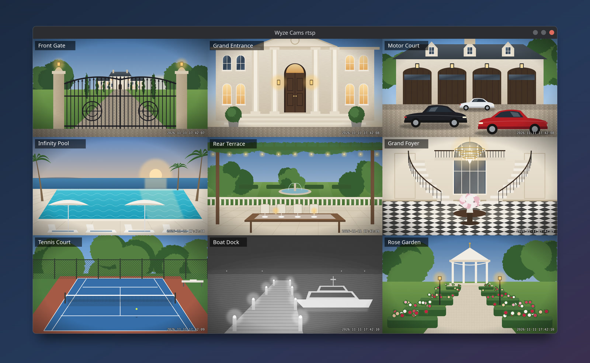
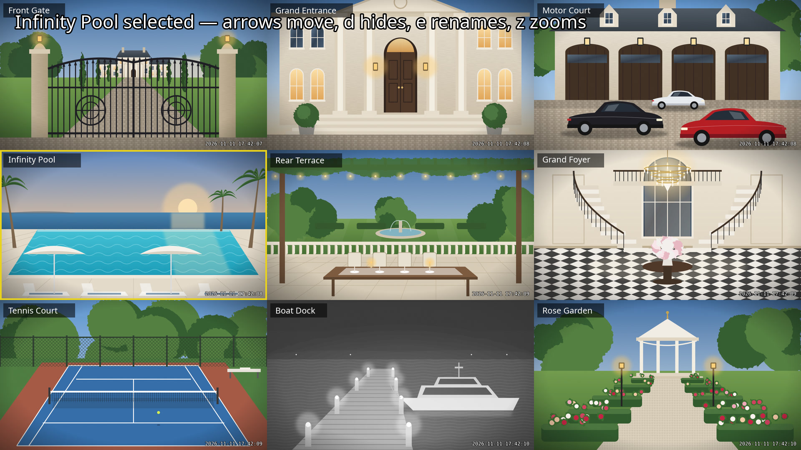
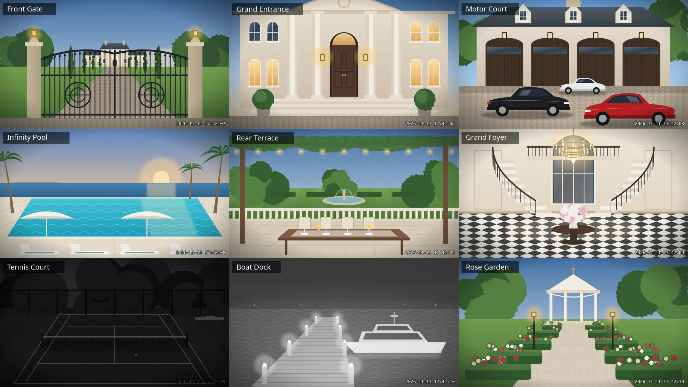
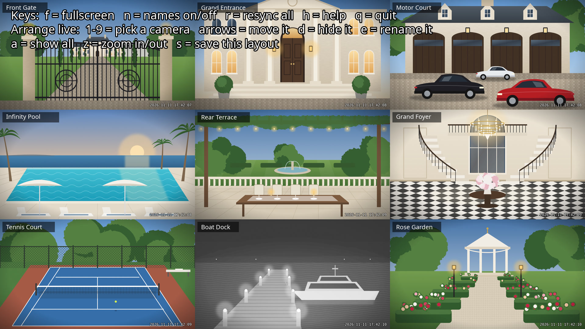
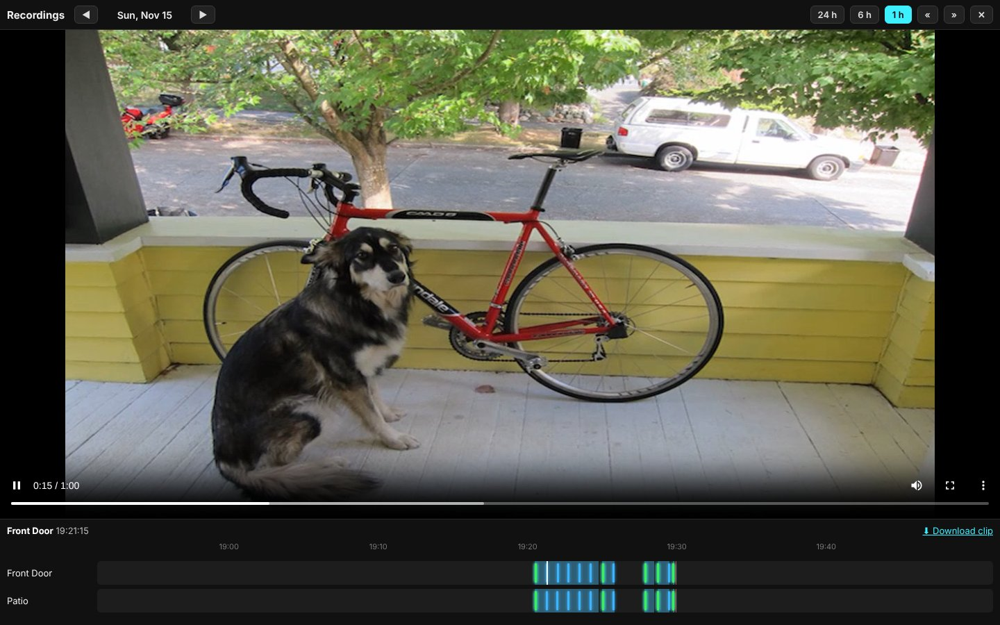
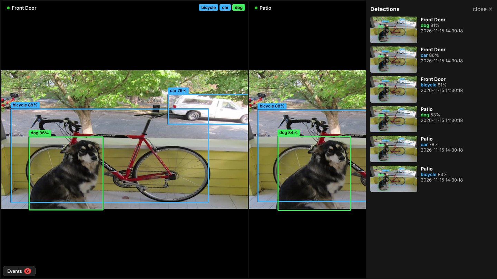

# wyzecam-rtsp

View your Wyze cameras' built-in RTSP streams in one live grid on **Linux, macOS or Windows**:
no Wyze app and no cloud. It scans your network, finds the cameras, and shows them tiled in a
single window with names, auto-reconnect, and live rearranging. It can also **record every
camera to your PC or a NAS**, show them in **any web browser**, spot **people and pets with local
AI**, and hand them to **Home Assistant**, all from one connection per camera.



**Project page:** <https://crash101g.github.io/wyzecam-rtsp/> · License: [GPL-3.0](LICENSE)

> **Important:** this only works with cameras that provide an RTSP stream, and it has only been
> tested with Wyze Cams. Other RTSP cameras may need a different port or stream path.

## Screenshots

| | |
|---|---|
|  |  |
| **Arrange live:** press 1–9 to pick a camera (yellow border), then use the arrow keys to move it and **s** to save the layout. | **Zoom:** press **z** to fill the window with the selected camera, and **z** again to go back to the grid. |
|  |  |
| **Keeps going:** a camera that drops turns dark grey and reconnects by itself. The other cameras keep playing. | **Help on screen:** press **h** to show every key. |

*These are illustrated mockups. The estate scenes are drawings, but the layout, name labels,
selection border, grey reconnecting tile and on-screen messages match what the app shows.*

## 1. Turn on RTSP on each camera

RTSP is **off by default**. For each camera whose model and firmware support it, open the Wyze
mobile app: camera → **Settings → Advanced Settings → RTSP**, turn it on, and set a username and
password. Tested with Cam v3, Cam Pan v3 (production firmware) and Cam v4 (RTSP firmware).

Use the same username and password on every camera. Type them at the login prompt, or fill in
`DEFAULT_USER` / `DEFAULT_PASS` near the top of the script (or set `WYZE_RTSP_USER` /
`WYZE_RTSP_PASS`) so you can just press Enter.

## 2. Install (once)

| OS | Install | Run |
|---|---|---|
| **Linux** (Pop!_OS / Ubuntu) | `sudo apt install python3 ffmpeg mpv` | `./wyzecam-rtsp.py` |
| **macOS** | `brew install python ffmpeg mpv` | `./wyzecam-rtsp.py` |
| **Windows** | Python from [python.org](https://www.python.org/downloads/), then<br>`winget install -e --id Gyan.FFmpeg`<br>`winget install -e --id shinchiro.mpv` | `py wyzecam-rtsp.py` |

Put `wyzecam-rtsp.py` in its own folder. Its camera list (`cameras.json`) and logs are kept
next to it. On Linux/macOS, run `chmod +x wyzecam-rtsp.py` once.

**First-run permissions:**
- **macOS:** the first scan triggers a **Local Network** permission request for your terminal app.
  Allow it (System Settings → Privacy & Security → Local Network). Without it the scan finds nothing.
- **Windows:** if Windows Firewall asks about Python, allow it on **Private networks**.
  Open a new terminal after installing ffmpeg/mpv so they're on the PATH.

## 3. Use it

On Windows, use `py wyzecam-rtsp.py` wherever this says `./wyzecam-rtsp.py`.

```
./wyzecam-rtsp.py                 # play all cameras (scans automatically the first time)
./wyzecam-rtsp.py --scan          # rescan the network, then play
./wyzecam-rtsp.py -c 243,patio    # only these cameras, in this order
./wyzecam-rtsp.py -x 75           # everything except camera 75
./wyzecam-rtsp.py --sub           # lighter substreams: less Wi-Fi and CPU, plenty for a grid
./wyzecam-rtsp.py name            # name cameras while watching each one
./wyzecam-rtsp.py arrange         # set the saved order / which cameras show
./wyzecam-rtsp.py --list          # list saved cameras
./wyzecam-rtsp.py --help          # every option

./wyzecam-rtsp.py --record /mnt/nas/cams        # grid + record every camera to a NAS
./wyzecam-rtsp.py --web                         # grid + browser view on port 8080
./wyzecam-rtsp.py serve --web --record /mnt/nas/cams   # no window (server / container)
./wyzecam-rtsp.py ha                            # Home Assistant setup for each camera
```

**Keys in the grid** (click the window first):

| Key | Action | Key | Action |
|---|---|---|---|
| f | fullscreen | 1–9 | select a camera (yellow border) |
| n | names on/off | arrows | move the selected camera |
| r | resync all to live | d | hide it |
| h | help | e | rename it |
| q | quit | a | show all hidden |
| z | zoom selected | s | save the layout |

A **dark grey tile** means that camera has no live video right now. It keeps retrying on its own.

## Record to your PC or a NAS (`--record`)

### Recommended setup

For most homes, start with the last 24 hours, recorded on this computer, as MP4:

```
./wyzecam-rtsp.py serve --record ~/Videos/wyzecams --rec-format mp4 --keep 1
```

- **Record locally first.** An internal drive or a USB drive (`/media/you/BigDrive/cams`) is the
  simplest and most reliable option: there's no network share to mount and nothing that can drop
  mid-recording. Use a NAS when you want recordings to survive this computer being stolen or
  dying, or when the computer isn't on all the time.
- **Use MP4 (`--rec-format mp4`).** The files open on phones, in browsers, in QuickTime and in
  Home Assistant, so a clip is easy to share. They still survive a crash. Stay with the default
  MKV only if you play everything in VLC or mpv.
- **Keep 24 hours (`--keep 1`).** That's usually enough to look back at "what happened last
  night", and it keeps disk use predictable. Raise it once you've measured your own cameras (see
  below).
- **Run `serve` on a machine that's always on.** Recording stops while the computer sleeps or is
  off. `serve` also doesn't do the grid's 10-minute resync, so recordings have no gaps.
- **Use `--sub` to save space** if detail isn't critical. Substreams take a fraction of the space
  (see below).

### How much disk space?

The camera sets the bitrate (RTSP has no quality setting), and it changes with the scene. Motion,
trees in wind, rain and night noise all use more space. These are planning figures, **per camera**:

| Stream | Per hour | Per 24 hours (`--keep 1`) | Per 7 days (`--keep 7`) |
|---|---|---|---|
| Main stream (Cam v3 1080p / Cam v4 2.5K) | about 0.4–0.7 GB | about 10–16 GB | about 70–110 GB |
| Substream (`--sub`) | about 0.15–0.2 GB | about 4–5 GB | about 25–35 GB |

Multiply by the number of cameras. For example, **6 cameras on the main stream for 24 hours need
about 60–100 GB**, and the same 6 kept for 7 days need about 0.4–0.7 TB. Leave at least 20% of the
drive free.

Where these numbers come from:
- Wyze rates a 128 GB card at about 192 hours of HD video, which is about 0.6 GB per hour
  ([Wyze](https://www.wyze.com/de/products/cam-v4-outdoor-bundle)).
- Cam v4 owners report a little over 9 GB a day of continuous 2.5K recording
  ([Wyze forum](https://forums.wyze.com/t/micro-sd-card-storage-continuous-recording-capacity/306346)).
- Others see about 10 MB a minute, about 14 GB a day
  ([Wyze forum](https://forums.wyze.com/t/sd-card-recording-and-hd-sd-360p-settings/342954)).
- The substream figure is from Wyze's SD-quality rating (672 hours on 128 GB).

The RTSP stream can differ from what the camera writes to its SD card, so **measure your own**:
record for an hour, then check the folder sizes:

```
du -sh ~/Videos/wyzecams/*        # Linux/macOS: size per camera
```

On Windows, right-click each camera folder and choose Properties. Multiply each camera's hourly
size by 24 × the days you keep.

### Details

```
./wyzecam-rtsp.py --record /mnt/nas/cams                 # while watching the grid
./wyzecam-rtsp.py serve --record /mnt/nas/cams           # no window
./wyzecam-rtsp.py serve --record /mnt/nas/cams --keep 14 --segment 10
./wyzecam-rtsp.py serve --record /mnt/nas/cams --rec-format mp4   # phone/browser-friendly files
```

- Each camera gets its own folder: `/mnt/nas/cams/Front Door/Front Door_2026-11-15_14-05-00.mkv`.
- Files are cut on the clock (every 5 minutes by default, `--segment MIN`), so it's easy to find
  a time. Recordings older than 7 days are deleted (`--keep DAYS`, `0` = keep forever). Only
  files this tool made are ever deleted.
- The video is **copied as-is**, not re-encoded, so recording barely uses any CPU. Audio is
  converted to AAC.
- **File type** (`--rec-format`):
  - `mkv` (default): stays playable even if the power goes out mid-file. Open it in VLC or mpv.
  - `mp4`: *fragmented* MP4, which also survives a crash and plays in web browsers, phone photo
    apps, QuickTime and Home Assistant's media browser. Good for sharing clips. H.265 cameras are
    tagged so Apple devices can play them.
- Recording uses the **same camera session** as the grid or browser view, so it doesn't add load on
  the camera. Hidden cameras keep recording.
- Point `--record` at any folder: a mounted NAS share (Linux: mount it with `cifs`/`nfs` first;
  macOS: `/Volumes/cams`; Windows: `\\nas\cams` works directly). The tool checks it can write
  there before it starts.
- Expect a gap of a few seconds whenever a camera reconnects (Wi-Fi drop, or the grid's
  10-minute resync). For gap-free recording, run `serve`, which doesn't resync by default.
- A camera whose main stream keeps dropping switches to its substream (lower resolution), and
  so do its recordings.

## Browser view (`--web`)

```
./wyzecam-rtsp.py --web                  # alongside the grid, on port 8080
./wyzecam-rtsp.py serve                  # no window, browser view only
./wyzecam-rtsp.py serve --web 8090 --record /mnt/nas/cams
```

Open `http://<this computer's IP>:8080/` on any phone, tablet, PC or TV browser and log in with
your **RTSP username and password**. You get a live grid with names. Click a camera to zoom, and
press **f** for fullscreen or **n** to toggle names. A grey tile means that camera has no live
video right now.

- It's served from each camera's existing session, so ten people watching still add **no load on
  the cameras**.
- Each camera also has an **MJPEG stream** at `/cam/<id>.mjpg` and a **snapshot** at
  `/cam/<id>.jpg`. `<id>` is the last number of the camera's IP, e.g. `/cam/243.mjpg`. Those work
  in Home Assistant, VLC and mpv.
- It's plain HTTP with a password, meant for your home network. Don't forward the port to the
  internet. Use `--web-bind 127.0.0.1` to allow only this computer.
- Decoding every camera for the browser costs CPU. On a small server, add `--sub` (substreams).
- Windows: allow Python on **Private networks** if the firewall asks.

## Play recordings in the browser

When the browser view and recording are both on, the page gets a **▶ Recordings** button
(or press **r**):

```
./wyzecam-rtsp.py serve --web --record ~/Videos/wyzecams --rec-format mp4 --keep 1 --detect
```



*Real capture: two test cameras, 1-hour zoom. The markers are detection events.*

- **A timeline per camera** for the day. Shaded parts were recorded; gaps are times nothing was
  recorded.
- **Click anywhere** on a timeline to play from that moment. Files play on into the next one, so
  it watches like one long video.
- **Event markers** (with `--detect`) use the box colours: red for people, green for pets, blue
  for vehicles. Click a marker, or **▶ Play recording** in the events panel, to jump to 5 seconds
  before the detection.
- **◀ ▶** change the day, **24 h / 6 h / 1 h** zoom in, **« »** move earlier or later, and
  **⬇ Download clip** saves the current file as MP4.
- Works on phones. Live tiles pause while you're watching recordings, to save bandwidth.
- **MKV recordings play too.** The first time a file is played, it's copied into a
  browser-friendly MP4 (no re-encoding, about a second) and kept in a temp folder for 2 hours. The
  file that's still recording plays up to the last minute or so.

## Local AI detection (`--detect`)

Detects **people, dogs and cats** (plus cars, trucks, birds and 70 other things if you ask)
**on your own computer**, with no cloud and no subscription.



*Real capture: two test cameras playing a sample photo from the YOLOX project (Apache-2.0), with live boxes and the events panel (press **e**).*

```
python3 -m pip install onnxruntime numpy          # once (Linux: add --break-system-packages)
./wyzecam-rtsp.py --detect                        # grid with boxes around people and pets
./wyzecam-rtsp.py serve --web --detect            # no window: browser view + detection
./wyzecam-rtsp.py serve --detect --record ~/Videos/wyzecams --rec-format mp4 --keep 1
./wyzecam-rtsp.py --detect --detect-labels person,dog,cat,car --detect-cams "front door,driveway"
```

What you get:
- **Boxes on the tiles** in the grid and the browser view, coloured by type: red for people,
  green for pets, blue for vehicles.
- **One event per visit, not hundreds.** Objects are tracked, so someone walking across the yard
  is a single event, which ends 30 s after they leave.
- **A snapshot of each event** with the objects outlined, saved to
  `events/YYYY-MM-DD/`, plus a line in `events/events.jsonl` (start and end, with duration).
  Kept 7 days (`--detect-keep`).
- **An events panel** in the browser view: press **e** or tap **Events**, then tap a thumbnail to
  open the snapshot.
- **Home Assistant / automations:** `--detect-webhook URL` POSTs each new detection as JSON. In
  Home Assistant, create an automation with a **Webhook** trigger and use its URL
  (`http://homeassistant.local:8123/api/webhook/<id>`). The JSON has `camera`, `label`,
  `score`, `snapshot` and `time`.

How it stays light:
- Each camera's existing connection sends **2 small frames a second** (`--detect-fps`) to one
  shared AI model, so the cameras get no extra load.
- A **motion check** runs first. The AI only looks when something moved, while it's following an
  object, or every 10 s (to catch something that arrived and stopped).
- **Models** come from [YOLOX](https://github.com/Megvii-BaseDetection/YOLOX) (Apache-2.0,
  trained on COCO). Each is downloaded once into `models/` and checksum-verified:

  | `--detect-model` | Size | Time per check* | Notes |
  |---|---|---|---|
  | `nano` | 4 MB | ~20 ms | Fastest. Mixes up pets more often. |
  | `tiny` (default) | 20 MB | ~65 ms | Good balance. |
  | `s` | 36 MB | ~240 ms | Most accurate. Fine for a few cameras. |

  \*Measured on a 2-core cloud VM. A desktop CPU is usually faster. The 10-minute status line in
  the log shows your real number.
- The motion-first and object-tracking design follows [Frigate NVR](https://github.com/blakeblackshear/frigate)'s
  approach. No Frigate code or models are included.

**Packages:** the standard COCO-trained models have no "package" label. To add one, train or
download an ONNX model that detects packages and pass it with `--detect-model my_model.onnx`.
Put its class names in `my_model.txt` next to it, one per line. Models in the YOLOX layout and
the YOLOv8/v9 layout both work. Check the model's license before sharing it.

## Home Assistant (`ha`)

```
./wyzecam-rtsp.py ha
```

This prints what to type into Home Assistant for each camera. No login is needed, and your
password is never printed. There are two ways to add a camera:

- **Generic Camera, straight from the camera:** use the `rtsps://` stream URL, set RTSP transport
  to TCP, and turn **Verify SSL off**, because Wyze cams use a self-signed certificate. This works
  without this tool running, but every Home Assistant viewer is one more camera session.
- **MJPEG IP Camera, through this tool's browser view:** run `serve` (or `--web`) on an
  always-on machine. Home Assistant then shares the tool's single session per camera.

## How it behaves

- Each camera has its own decoder and reconnect loop, so a bad camera never freezes the others.
- Every camera reconnects every 10 minutes (staggered) to stay close to live (`--resync`).
- A camera whose main stream keeps dropping switches to its substream automatically,
  and that setting is saved.
- GPU decoding is used where available: VA-API on Linux, VideoToolbox on macOS, D3D11 on Windows.
- Logs: `wyzecam-rtsp.log` (events) and `wyzecam-rtsp-ffmpeg.log` (details, passwords removed).

## Using it alongside the Wyze app, and during internet outages

**Can I still use the Wyze phone app?** Yes. Turning on RTSP is just a setting, and the Wyze app
keeps working: motion alerts, event clips, and settings are unaffected. Live view in the app is a
second, separate stream from the camera, though, so be aware of two things:

- On cameras with weak Wi-Fi, opening live view on your phone can make that camera's grid tile drop
  for a moment. The grid reconnects it on its own.
- Some owners report that the Wyze app's live view becomes unreliable on certain firmware while RTSP
  is streaming, notably the [Cam v4 RTSP beta](https://forums.wyze.com/t/wyze-cam-v4-firmware-beta-test-7-27-2026/344026?page=3)
  and the [February 2026 Cam v3 / Pan v3 firmware](https://forums.wyze.com/t/wyze-firmware-updates-2-2-2026/340669?page=3).
  If that happens to you, it's the camera firmware, not this tool. Check each camera's live view in
  the app while the grid is running.

**Is the video local? Does it work without internet?** The video goes **directly from each camera to
your computer over your home network**. It never passes through the internet or Wyze's servers, and
this tool needs no internet connection.

Whether the *cameras* keep streaming RTSP when your internet goes down is a separate question:

- **While the cameras stay powered on, owners report that RTSP keeps working.** For example, a
  [Pan v3 owner unplugged their internet](https://forums.wyze.com/t/isp-down-and-no-local-access/343086)
  and could still stream over RTSP while the Wyze app showed every camera offline, and another
  [kept RTSP through a 16-hour ISP outage](https://forums.wyze.com/t/can-you-use-cams-without-internet/24471?page=3).
- **A camera that restarts or loses power while the internet is down may not come back.** Wyze cams
  check in with Wyze's cloud when they start up, and reports
  [differ](https://forums.wyze.com/t/rtsp-local-availability-when-internet-or-wyze-servers-down/55033)
  on whether RTSP returns without it.
- **Cam v4:** no offline reports found yet for its newer RTSP firmware.

**Test it on your own cameras:** with the grid running, block the cameras' internet access in your
router for an hour and watch the tiles. Then restart one camera while it's still blocked and see
whether it returns.

## Checklist for a first run on macOS / Windows

These parts were tested on Linux and simulated for macOS/Windows, but haven't yet run on a real
Mac or Windows PC. On the first run, check:

1. `--scan` finds your cameras. (macOS: Local Network permission. Windows: firewall prompt.)
2. The grid opens and every tile moves.
3. Camera names appear on the tiles. If not, the font lookup needs a tweak.
4. Keys work: **h** shows help on screen, **1** then **→** moves a camera, **e** opens a rename box.
5. **q** quits cleanly and `wyzecam-rtsp.log` says "grid stopped".

If anything fails, run it again with `--verbose` and keep the terminal output and both log files.

## Troubleshooting

| Symptom | Likely cause / fix |
|---|---|
| Scan finds no cameras | RTSP not enabled in the Wyze app; wrong subnet (`--subnet 192.168.1.0/24`); macOS Local Network permission |
| "login rejected" | Username/password differ from the camera's RTSP login |
| A tile keeps going grey | Weak Wi-Fi at that camera: try `--sub`, or move an access point closer |
| "camera refused the connection" | Too many viewers on that camera (Wyze app, other players). Close them, wait a minute |
| Everything stutters | Use `--sub`, or `--fps 10` |
| "can't write to the recording folder" | NAS share not mounted, or mounted read-only / as another user |
| Recordings play too fast or too slow | Please open an issue with `wyzecam-rtsp-ffmpeg.log`: the recordings use the time each frame arrived as its timestamp, because Wyze streams don't carry usable ones |
| Browser view keeps asking for a login | Use the RTSP username/password, not your Wyze account |
| Browser view says the port is in use | Pick another: `--web 8081` |
| "object detection needs two Python packages" | `python3 -m pip install onnxruntime numpy` (Linux: add `--break-system-packages`, or use a venv) |
| Detection is slow / high CPU | `--detect-model nano`, `--detect-fps 1`, or `--detect-cams` to limit it to the cameras that matter |
| Too many false alarms | Raise `--detect-score 0.6`, or use `--detect-model s` |
| A pet is sometimes called a cat, sometimes a dog | Normal for small models. Tracking keeps it as one event; `--detect-model s` is better at it |
